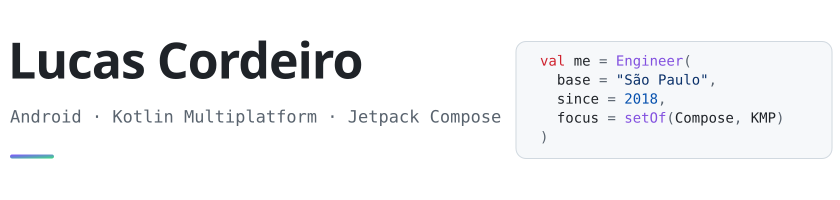

<picture>
  <source media="(prefers-color-scheme: dark)" srcset="assets/header-dark.svg">
  
</picture>

I build Android apps, from products with millions of users to early-stage startups.
I care about Compose UIs that feel good in the hand and code that stays simple as it grows.
Lately I've been going deeper into Kotlin Multiplatform, and on the side I make games in Unity.

### Building

- **[Ymir](https://github.com/lucas-cordeiro/Ymir)**: a small ViewModel library for Compose that handles state and actions on top of coroutines and Flow. Published on Maven Central.
- **[poc-cards](https://github.com/lucas-cordeiro/poc-cards)**: a Compose motion study where a fan of cards opens into a carousel, with every parameter tunable at runtime.
- **[community-app](https://github.com/lucas-cordeiro/community-app)**: modular Clean Architecture with Compose, reactive MVVM, CI and test coverage.
- **[nexly](https://github.com/lucas-cordeiro/nexly)**: a minimal explorer for crypto exchanges, built with Compose and Material 3.

### Toolbox

Kotlin · Jetpack Compose · Coroutines & Flow · Kotlin Multiplatform · Koin · Gradle · Firebase 
and off the clock: Unity · C# · Blender
